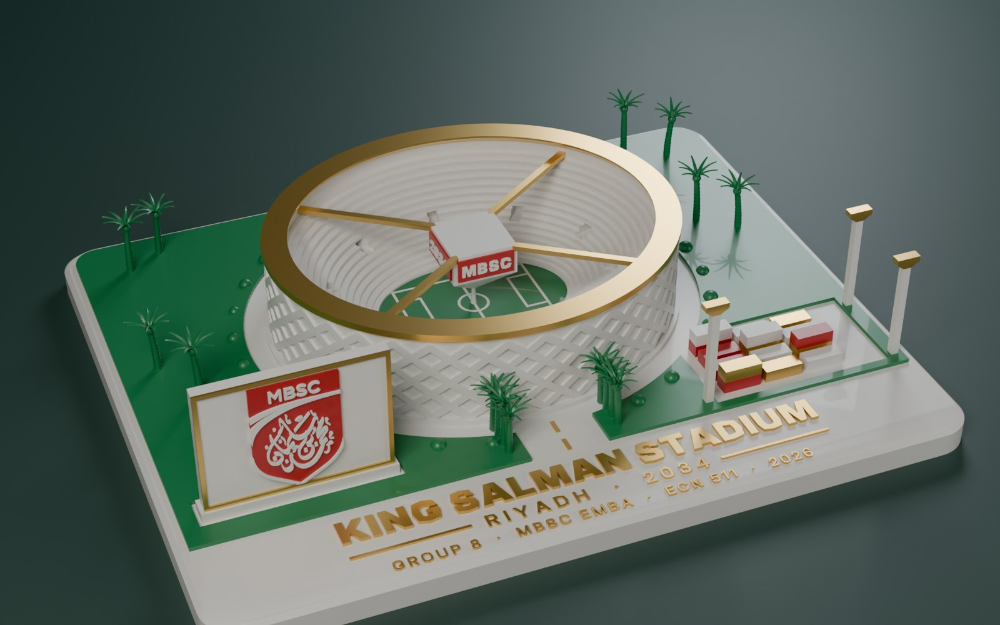

# King Salman Stadium keepsake — 4-colour 3D print

A print-ready landscape model of the stadium scene from the 3D presentation, in two sizes, for a Bambu Lab X1 Carbon with the AMS.

**What's on it:** the stadium itself, with its stepped seating bowl, criss-cross facade, gold roof ring, centre-hung scoreboard on four cables and the pitch with its markings. Around it, the same scene as the presentation: the approach road with an avenue of date palms, the billboard carrying the MBSC shield, the container yard and floodlight masts, all on a landscaped plinth.

The plinth carries three lines of raised gold lettering, each in its own size and weight of Inter Display:

| Line | Weight | Cap height (large / small) |
|---|---|---|
| **KING SALMAN STADIUM** | Black | 7.6 mm / 4.2 mm |
| RIYADH · 2034 (with gold rules either side) | SemiBold, letter-spaced | 4.0 mm / 2.7 mm |
| GROUP 8 · MBSC EMBA · ECN 511 · 2026 | Medium (SemiBold on the small model) | 3.1 mm / 2.4 mm |

| | Large | Small |
|---|---|---|
| Size | 210 × 170 × 47 mm | 109 × 88 × 27 mm |
| Shield on the billboard | full logo, including the calligraphy | bold MBSC and swoosh (the calligraphy is finer than a 0.4 mm nozzle at this size) |
| Pitch markings, scoreboard lettering, floodlight masts | yes | left out (too fine) |

## Files

| File | Use |
|---|---|
| `print/stadium_large_4colour.3mf`, `print/stadium_small_4colour.3mf` | **Open these first.** One object with four parts, already assigned to AMS slots 1–4. |
| `print/stadium_<size>_<slot>_<colour>.stl` | The same four parts as separate STLs, if the 3MF doesn't load its colours |
| `preview/interactive_large.html`, `preview/interactive_small.html` | Turn the model in a browser (drag to rotate, scroll to zoom) |
| `preview/render_*.jpg` | Blender (Cycles) renders |
| `source/statue.py` | Generates every print file. `python statue.py OUT_DIR` |
| `source/render_blender.py` | Makes the renders. `python render_blender.py PRINT_DIR large OUT.png hero` |

## AMS slots

| Slot | Colour | Parts |
|---|---|---|
| 1 | White | plinth, stadium, seating, scoreboard body, billboard, white containers, lettering on red |
| 2 | Green | lawns, pitch, palms, shrubs |
| 3 | Gold (silk gold looks best) | text, roof ring, cables, billboard frame, mast heads, road dashes, gold containers |
| 4 | Red | MBSC shield, scoreboard screens, red containers |

## Printing on the X1C (Bambu Studio)

1. Open the 3MF. If Bambu Studio asks whether to load it as one object with multiple parts, choose **Yes**.
2. Check each part's filament in the Objects list matches the table above. If you used the STLs instead, select all four, right-click → *Assemble*, then set each part's filament.
3. Settings:
   - **0.16 mm** layer height (0.12 mm for the small one), 0.4 mm nozzle
   - **15% gyroid** infill, 3 walls
   - **Supports: off**. The roof ring, scoreboard, mast heads and fronds are shaped with 45° undersides. The cables print as short bridges between the board and the wall top. The palm tips are the one delicate exception (see Notes).
   - Prime tower on. Under *Flushing options*, turn on **Flush into objects' infill** to cut purge waste.
4. **The scoreboard** sits on a thin pin standing on the pitch, so it can print without supports. Leave the pin as a mount, or snap it off at the tapered top with flush cutters once printed.

**Expect a long print.** The colours change on almost every layer through the lower part (lawn, palms, containers, billboard). I couldn't slice it here, so I have no time estimate; Bambu Studio shows the real figure after slicing. The small one is a good first test of colours and detail.

## Notes

- The palm fronds are the most delicate part. If the tips look stringy, enable supports for the palms only, using painted tree supports.
- The stadium is a stylised model built from the presentation's 3D scene, not Populous's architectural design.
- The MBSC shield is traced from the logo used in the presentation. Check that you may reproduce the college's logo for your purpose.
