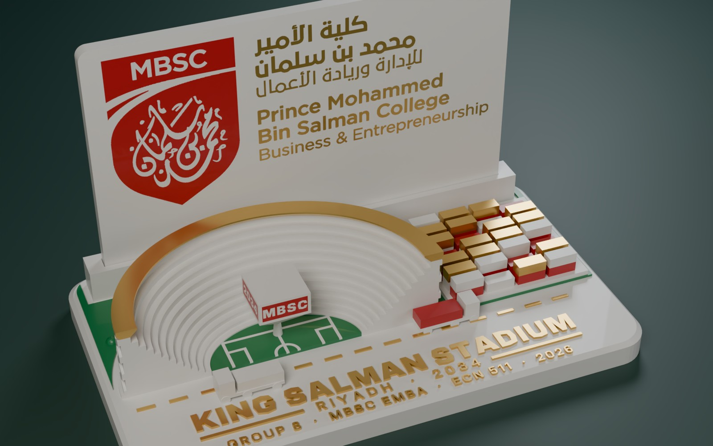
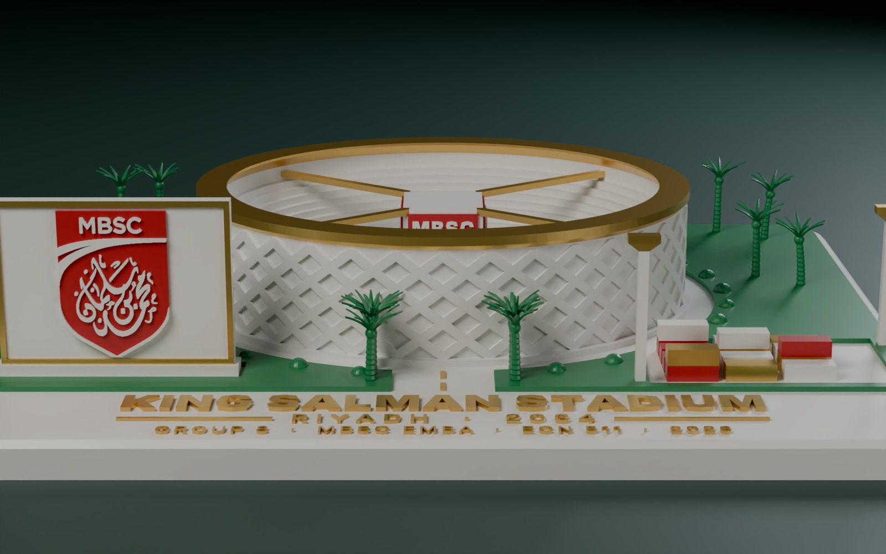
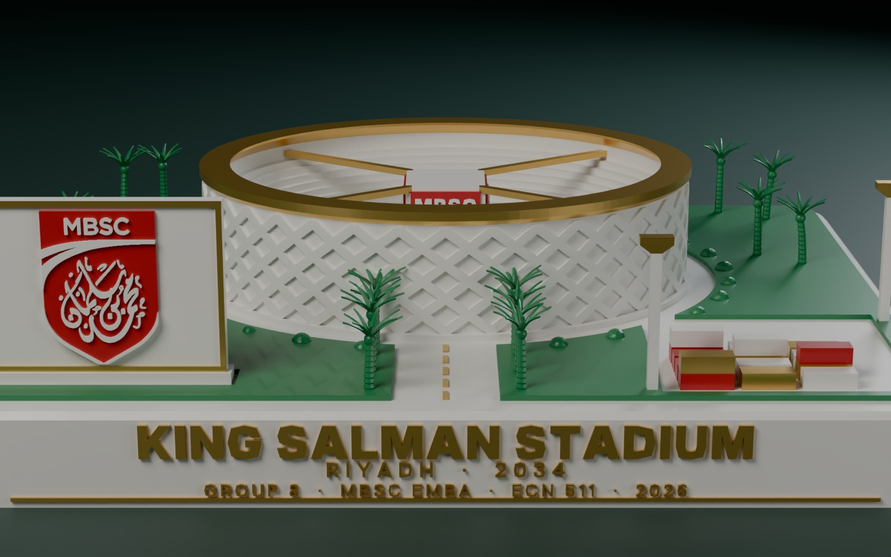
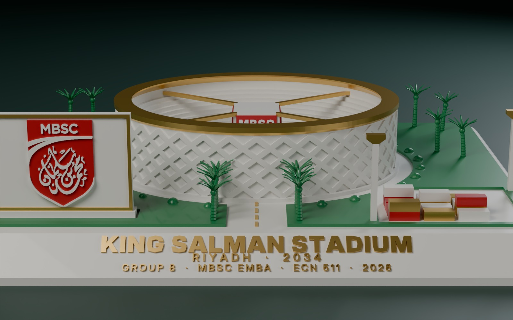
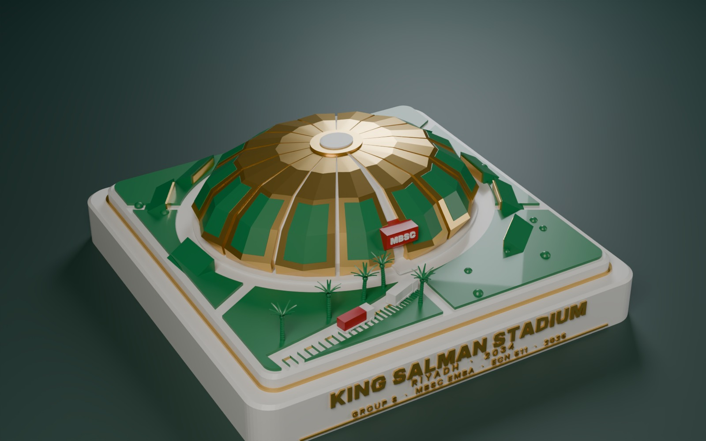
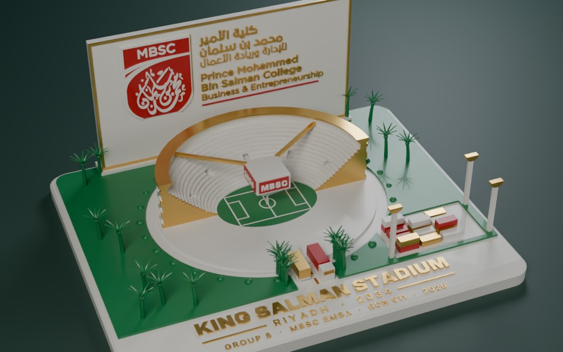
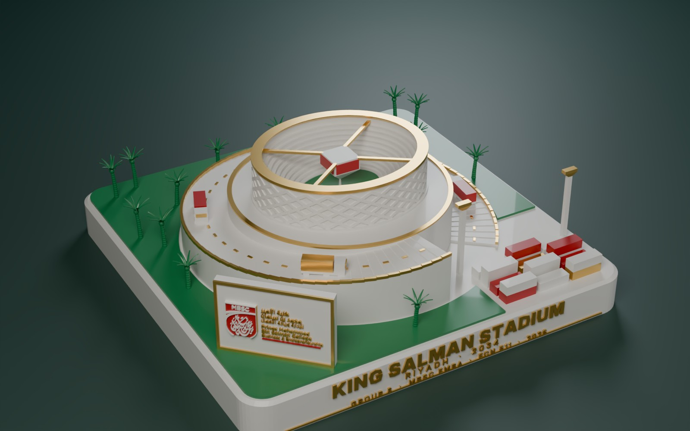
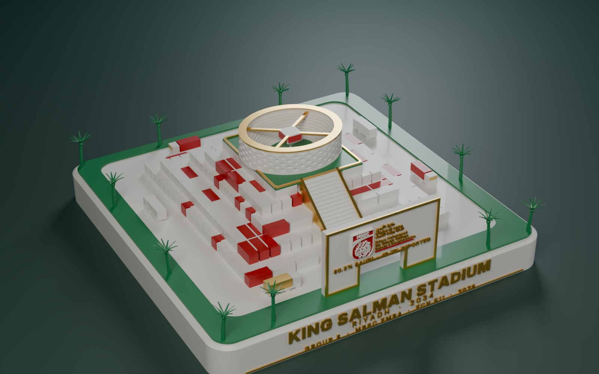

# King Salman Stadium keepsake — 4-colour 3D print

A print-ready landscape model of the stadium scene from the 3D presentation, in two sizes, for a Bambu Lab X1 Carbon with the AMS.

**What's on it:** the stadium itself, with its stepped seating bowl, criss-cross facade, gold roof ring, centre-hung scoreboard on four cables and the pitch with its markings. Around it, the same scene as the presentation: the approach road with an avenue of date palms, the billboard carrying the MBSC shield, the container yard and floodlight masts, all on a landscaped plinth.

The plinth carries three lines of raised gold lettering, each in its own size and weight of Inter Display:

| Line | Weight | Cap height (large / small) |
|---|---|---|
| **KING SALMAN STADIUM** | Black | 7.6 mm / 4.2 mm |
| RIYADH · 2034 (with gold rules either side) | SemiBold, letter-spaced | 4.0 mm / 2.7 mm |
| GROUP 8 · MBSC EMBA · ECN 511 · 2026 | Medium (SemiBold on the small model) | 3.1 mm / 2.4 mm |

## ⚡ Light edition: a fast print, about 5–6 hours

A compact version: **118 × 69 mm base, 69 mm tall when assembled.** It keeps the parts that matter most:
- the stadium cut exactly in half, with its stepped bowl, diagrid facade, gold roof ring, half pitch with markings, and the scoreboard (red MBSC / 2034 screens);
- the container quay (red and white lower tier, gold and white upper tier) and two trucks on the road: an imported red container arriving, and a white, made-in-Saudi one leaving;
- the **official MBSC logo** on its own plaque (100 × 67 mm). Only the red shield and the college name in Arabic and English, built from the vector logo `source/mbsc_logo_official.svg`;
- three gold lines along the front: KING SALMAN STADIUM, RIYADH · 2034, and GROUP 8 · MBSC EMBA · ECN 511 · 2026.

**Why it is fast:** a colour swap costs 1.5–2 minutes, and it is needed on every layer that holds more than one colour. Here each colour stays in a short band of layers:
- the logo plaque prints **flat, face up**, with its colours inlaid in the top 0.6 mm (3 layers);
- the containers share one red band and one gold band;
- the stadium is white, with gold only on the top ring.

**Estimate, both parts on one plate at 0.16 mm:**
- 81 colour swaps;
- about 2 hours of printing;
- about 52 g of filament.

I estimated this with PrusaSlicer at X1C speeds and counted the swaps layer by layer. Expect **about 5–6 hours** in total; Bambu Studio shows the exact figure after slicing. Zero floating regions in a layer-by-layer check.

**File:** `print/stadium_light_4colour.3mf`. It holds two objects on one plate: the base and the plaque.
- Settings: 0.16 mm layers, 2 walls, 10% infill, supports off, prime tower on, *Flush into objects' infill* on.
- **Assembly:** push the plaque into the slot in the rail behind the stadium, logo facing the front. The slot is 3.5 mm wide for the 3.2 mm plaque. Add a drop of super glue in the slot if it is loose.

Generator: `source/light.py`.

## Three versions of the large model

The same full stadium scene, with the lettering in three places:

| Version | Where the text is | Size | File |
|---|---|---|---|
| **A · Classic** | a gold strip along the front of the top | 210 × 170 × 47 mm | `print/stadium_large_4colour.3mf` |
| **B · Monument** | the front face of a taller 20 mm plinth, like a monument plaque; the full MBSC logo on the back face | 210 × 172 × 59 mm | `print/stadium_monument_4colour.3mf` |
| **C · Nameplate** | a 45° sloped front edge, like a desk nameplate, reading from the front and from above | 210 × 170 × 54 mm | `print/stadium_nameplate_4colour.3mf` |

All three: no floating regions, checked with `source/check_floating.py`, which emulates the slicer at 0.2 mm layers (drops anything narrower than one 0.4 mm line, then flags any printable region with less than 15% support beneath it). Palm fronds are straight 45° blades, never thinner than 0.9 mm. Generated by `source/statue.py` (`text='top' | 'face' | 'bevel'`).

## ★ Signature edition — the real King Salman Stadium

The stadium as Populous designed it: a faceted dome of 14 folded petals (gold ridges framing green planted panels, white slots of light between them, the canyon entrance with a red MBSC media screen) in its park of green-roofed pavilions, radial paths, shrubs and the palm-lined approach with trucks. Two-tier award plinth, 170 × 170 × 59 mm: the three lines of lettering on the front face, the full MBSC logo (red shield, gold Arabic and English name) on the back.

Built print-first: every surface at 45° or less, the media screen on a 45° bracket, and **zero floating regions** in a layer-by-layer check. File: `print/stadium_signature_4colour.3mf` (generator: `source/signature.py`).

## Three editions

| Edition | What it is | File |
|---|---|---|
| **Large** | the whole stadium scene, 210 × 170 × 47 mm | `print/stadium_large_4colour.3mf` |
| **Small** | the same scene at half size, 109 × 88 × 27 mm | `print/stadium_small_4colour.3mf` |
| **Cutaway** | architectural section: the front half of the stands removed, the cut faces capped in gold, the scoreboard hanging over the full pitch, trucks bringing containers up the road, and a tall wall behind carrying the full college logo. 210 × 170 × 91 mm | `print/stadium_cutaway_4colour.3mf` |

### Two square editions (190 × 190 mm)

The same parts (stadium and scoreboard, trucks, containers, palms, the MBSC logo panel) arranged two new ways. On both, the three lines of lettering sit on the plinth's front face like a monument, leaving the whole top for the composition.

| Edition | The idea | File |
|---|---|---|
| **Ring Road** | The stadium sits high on a round dais. A terraced spiral road winds up to its gate, edged with a continuous gold kerb so the climb reads as one rising gold line, with trucks climbing it. Container port in one corner, the logo monolith in the opposite corner turned to face you. 190 × 190 × 62 mm | `print/stadium_ringroad_4colour.3mf` |
| **Built on Imports** | The stadium crowns a five-level stepped pyramid of shipping containers, about 80% white (made in Saudi, 80.3%) and 20% red (imported, 19.7%). A grand stair climbs the front through a logo gateway captioned 80.3% SAUDI · 19.7% IMPORTED. Trucks circle the pyramid. 190 × 190 × 60 mm | `print/stadium_imports_4colour.3mf` |

Generated by `source/editions.py`, which reuses the parts from `source/statue.py`.

| | Large | Small |
|---|---|---|
| Size | 210 × 170 × 47 mm | 109 × 88 × 27 mm |
| Shield on the billboard | full logo, including the calligraphy | bold MBSC and swoosh (the calligraphy is finer than a 0.4 mm nozzle at this size) |
| Pitch markings, scoreboard lettering, floodlight masts | yes | left out (too fine) |

## Files

| File | Use |
|---|---|
| `print/stadium_<edition>_4colour.3mf` | **Open these first.** One object with four parts, already assigned to AMS slots 1–4. |
| `print/stadium_<size>_<slot>_<colour>.stl` | The same four parts as separate STLs, if the 3MF doesn't load its colours |
| `preview/interactive_large.html`, `preview/interactive_small.html`, `preview/interactive_cutaway.html` | Turn the model in a browser (drag to rotate, scroll to zoom) |
| `preview/render_*.jpg` | Blender (Cycles) renders |
| `source/statue.py` | Generates every print file. `python statue.py OUT_DIR` |
| `source/render_blender.py` | Makes the renders. `python render_blender.py PRINT_DIR large OUT.png hero` |

## AMS slots

| Slot | Colour | Parts |
|---|---|---|
| 1 | White | plinth, stadium, seating, scoreboard body, billboard, white containers, lettering on red |
| 2 | Green | lawns, pitch, palms, shrubs |
| 3 | Gold (silk gold looks best) | text, roof ring, cables, billboard frame, mast heads, road dashes, gold containers |
| 4 | Red | MBSC shield, scoreboard screens, red containers |

## Printing on the X1C (Bambu Studio)

1. Open the 3MF. It is a Bambu Studio project file: when asked, choose **Load as project** so the four filament colours (white, green, gold, red) and the part-to-slot assignments come in with it. Then sync the filaments with your AMS.
2. Check each part's filament in the Objects list matches the table above. If you used the STLs instead, select all four, right-click → *Assemble*, then set each part's filament.
3. Settings:
   - **0.16 mm** layer height (0.12 mm for the small one), 0.4 mm nozzle
   - **15% gyroid** infill, 3 walls
   - **Supports: off**. The roof ring, scoreboard, mast heads and fronds are shaped with 45° undersides. The cables print as short bridges between the board and the wall top. The palm tips are the one delicate exception (see Notes).
   - Prime tower on. Under *Flushing options*, turn on **Flush into objects' infill** to cut purge waste.
4. **The scoreboard** sits on a thin pin standing on the pitch, so it can print without supports. Leave the pin as a mount, or snap it off at the tapered top with flush cutters once printed.

**Expect a long print.** The colours change on almost every layer through the lower part (lawn, palms, containers, billboard). I couldn't slice it here, so I have no time estimate; Bambu Studio shows the real figure after slicing. The small one is a good first test of colours and detail.

## Notes

- The palm fronds are the most delicate part. If the tips look stringy, enable supports for the palms only, using painted tree supports.
- The stadium is a stylised model built from the presentation's 3D scene, not Populous's architectural design.
- The MBSC shield is traced from the logo used in the presentation. Check that you may reproduce the college's logo for your purpose.
- The cutaway's logo wall is 80 mm tall and 4 mm thick, with five buttresses behind it. Print the cutaway with the wall towards the back of the plate, and keep the chamber door closed so drafts can't make the wall wobble.
